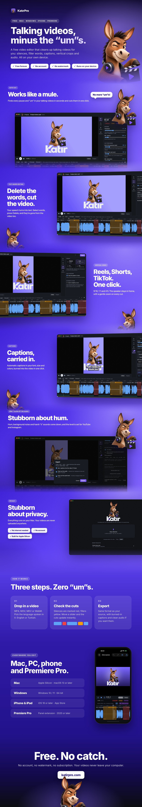

  
  
  
  

  

  
  
  
  

  <a href="https://katirpro.com">Website</a> ·
  <a href="https://github.com/artdzy/KatirPro-App/releases">Release notes</a> ·
  <a href="https://katirpro.com/destek">Support</a> ·
  <a href="#turkce">🇹🇷 Türkçe</a>

## Download

| Platform | File | Requirements |
|---|---|---|
| **Mac** | [KatirPro-mac-arm64.dmg](https://github.com/artdzy/KatirPro-App/releases/latest/download/KatirPro-mac-arm64.dmg) | Apple Silicon (M1 or later), macOS 13 Ventura or later |
| **Windows** | [KatirPro-Setup-win-x64.exe](https://github.com/artdzy/KatirPro-App/releases/latest/download/KatirPro-Setup-win-x64.exe) | Windows 10 / 11, 64-bit |
| **iPhone / iPad** | [App Store](https://apps.apple.com/app/id6815226267) | iOS / iPadOS 18 or later |
| **Premiere Pro** | [KatirPro-Premiere.zxp](https://github.com/artdzy/KatirPro-App/releases/latest/download/KatirPro-Premiere.zxp) | Premiere Pro 2020 or later (Beta too) |

- **Mac:** open the `.dmg` and drag KatırPro into Applications. The app is signed and notarized by Apple.
- **Windows:** if SmartScreen says “Windows protected your PC”, click **More info › Run anyway**. It only asks once.
- **Premiere Pro:** double-clicking the `.zxp` won't work. Install it with [ZXP Installer](https://aescripts.com/learn/zxp-installer/), then restart Premiere. The panel is under **Window › Extensions**.
- **Updates are automatic:** new versions download in the background and the app asks to restart.

## FAQ

<b>Is it really free?</b>

 
Yes. No account, no card, no subscription and no watermark.

<b>Are my videos uploaded anywhere?</b>

 
No. Analysis, speech recognition and rendering all happen on your computer. The internet is only used to check for updates.

<b>Which languages does it understand?</b>

 
Silence cutting works with any language. Filler detection (“um”, “uh”), text-based editing and captions work with English and Turkish speech. The interface follows your system language.

<b>Which formats are supported?</b>

 
MP4, MOV, MKV and WebM. Exports use the same format as the source.

<b>Does it run on Intel Macs?</b>

 
No, the Mac version is for Apple Silicon (M1 or later). Speech recognition runs on the GPU on Mac and on the CPU on Windows.

Found a bug or have an idea? [Open an issue](https://github.com/artdzy/KatirPro-App/issues). This repository hosts the installers and release notes; the app's source code is not published here.

---

## 🇹🇷 Türkçe

**KatırPro**, konuşma videolarındaki sessizlikleri ve “eee, ııı” gibi dolguları otomatik bulup tek tıkla kesen **ücretsiz** bir uygulama. Hesap yok, filigran yok, abonelik yok; videoların bilgisayarından hiç çıkmaz.

- **Otomatik jump-cut:** sessizlikler ve dolgular tek seferde kesilir, eşik ve paylar ayarlanabilir.
- **Metinden kes:** konuşman metne dökülür; kelimeleri sil, o kısım videodan da gider.
- **Dikey format:** 9:16, 1:1, 4:5. Yüz takibi konuşanı kadrajda tutar.
- **Otomatik altyazı:** yazı tipi, boyut ve renk senin; SRT / TXT içe ve dışa aktarma.
- **Sesi temizle:** uğultu, gürültü ve sert “s” sesleri azalır; ses YouTube / Instagram seviyesine (−14 LUFS) gelir.
- **Türkçe ve İngilizce:** arayüz sistem diline uyar, her videonun konuşma dilini seçebilirsin.

| Platform | İndir | Gereksinim |
|---|---|---|
| Mac | [.dmg](https://github.com/artdzy/KatirPro-App/releases/latest/download/KatirPro-mac-arm64.dmg) | Apple Silicon, macOS 13+ |
| Windows | [.exe](https://github.com/artdzy/KatirPro-App/releases/latest/download/KatirPro-Setup-win-x64.exe) | Windows 10 / 11, 64-bit |
| iPhone / iPad | [App Store](https://apps.apple.com/tr/app/kat%C4%B1rpro/id6815226267) | iOS 18+ |
| Premiere Pro | [.zxp](https://github.com/artdzy/KatirPro-App/releases/latest/download/KatirPro-Premiere.zxp) | Premiere Pro 2020+, ZXP Installer ile kur |

Windows'ta “Windows bilgisayarınızı korudu” uyarısı çıkarsa **Ek bilgi › Yine de çalıştır**'a tıkla. Sorular için: [katirpro.com/destek](https://katirpro.com/destek)

---

   
  KatırPro · <a href="https://katirpro.com">katirpro.com</a> · <a href="https://katirpro.com/privacy">Privacy</a>

