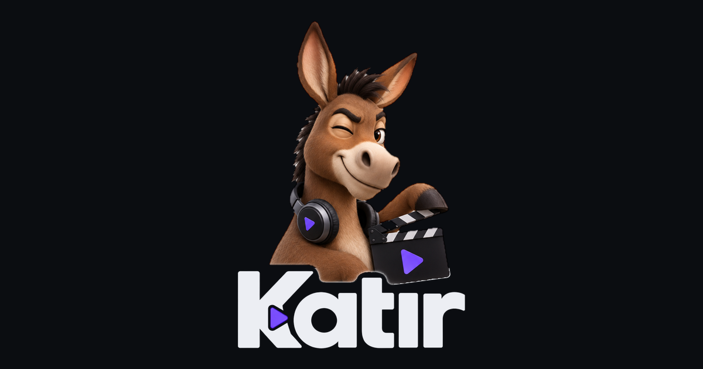
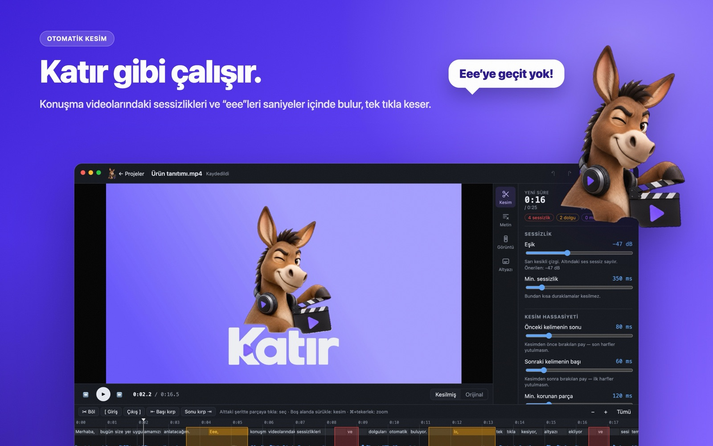
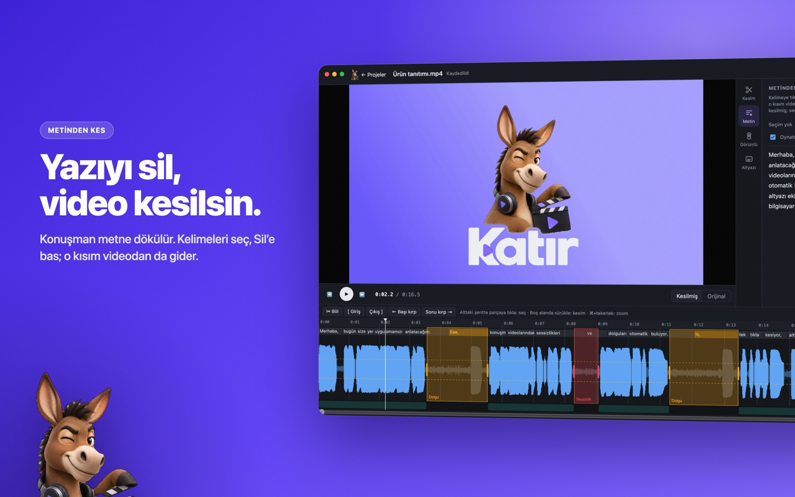
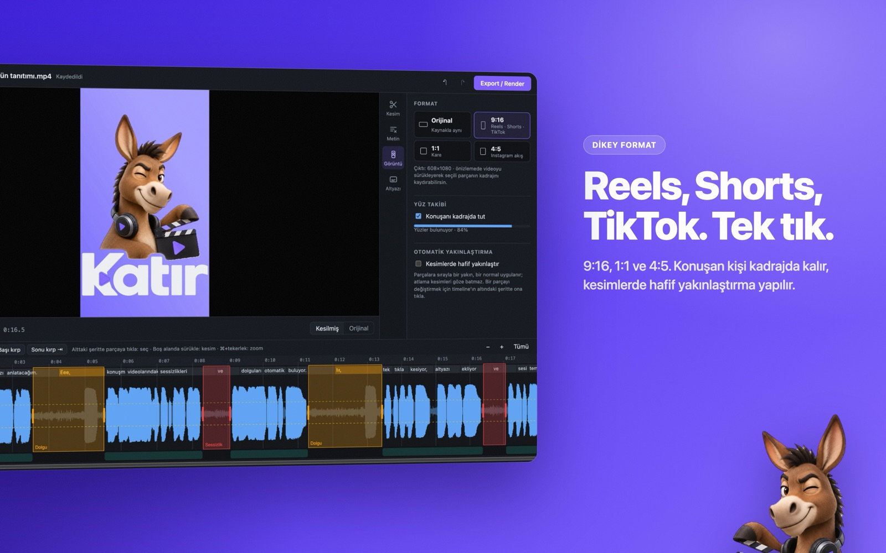
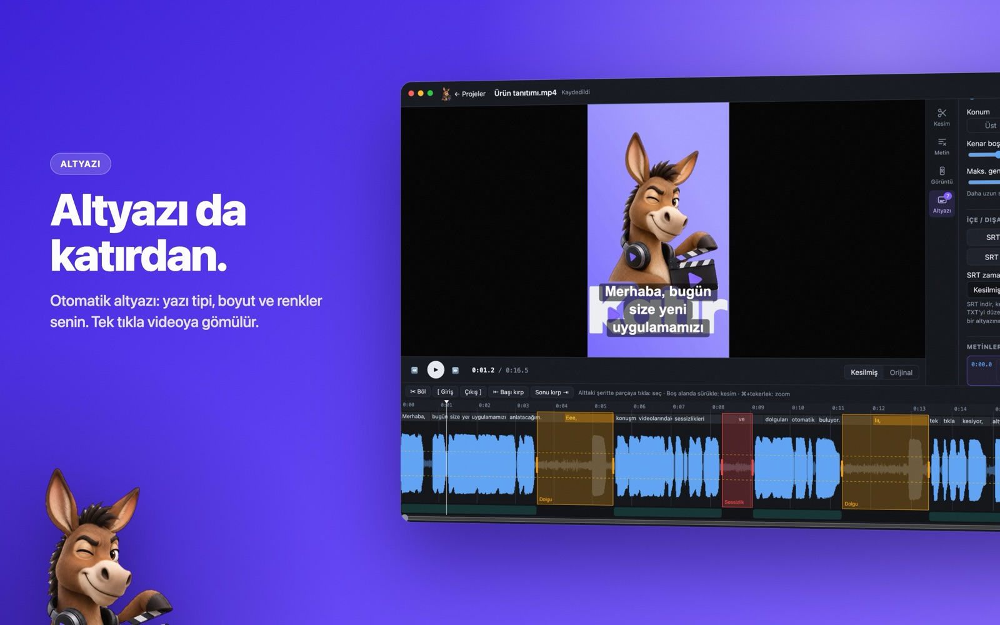
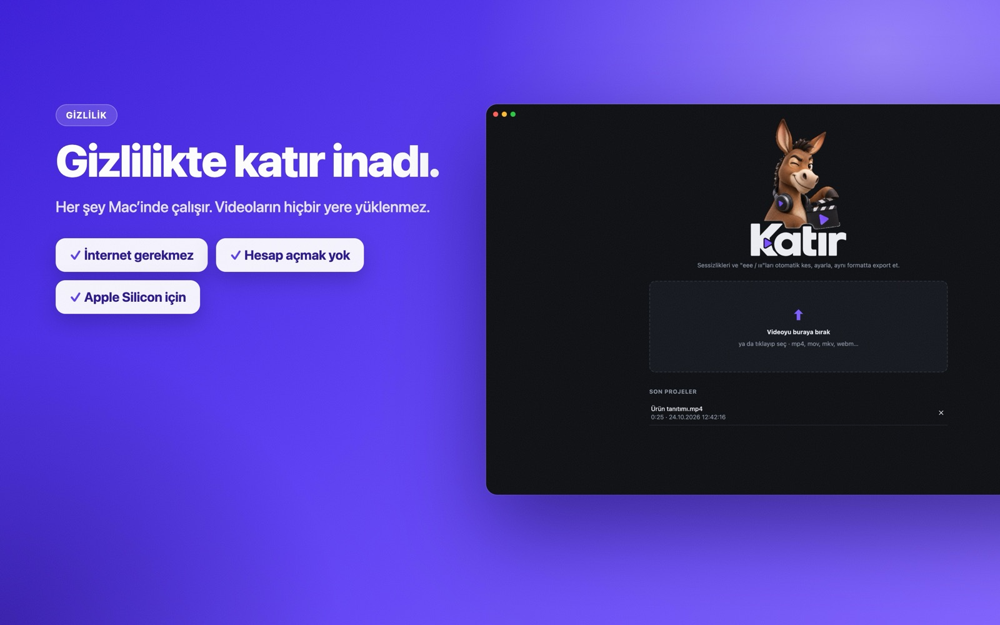
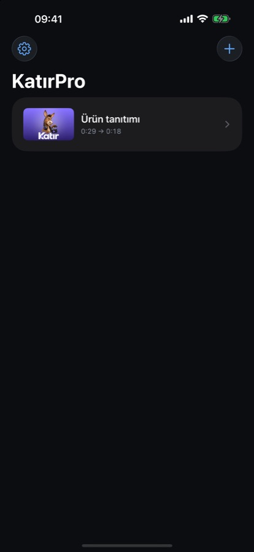
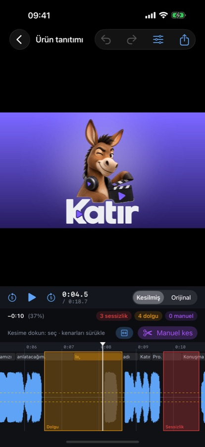
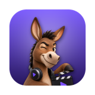

  

<h1 align="center">KatırPro</h1>

  <b>Konuşma videolarındaki sessizlikleri ve “eee, ııı”ları otomatik kesen ücretsiz jump-cut uygulaması.</b> 
  Hesap yok, filigran yok, abonelik yok. Videoların bilgisayarından hiç çıkmaz.

  
  
  
  

  
  
  
  

  <a href="https://katirpro.com">katirpro.com</a> ·
  <a href="https://katirpro.com/destek">Destek</a> ·
  <a href="https://github.com/artdzy/katirpro-releases/releases">Tüm sürümler</a> ·
  <a href="#english">English</a>

---

  

## Ne yapar?

Videoyu sürükleyip bırakırsın. KatırPro konuşmayı dinler, **sessiz anları** ve **“eee, ııı, hımm” gibi dolguları** bulur, timeline'da işaretler. Beğenirsen tek tıkla keser, kaynakla aynı formatta dışa aktarır. Saatlerce elle kesmek yerine birkaç saniye.

| | |
|---|---|
| ✂️ **Otomatik jump-cut** | Sessizlikleri ve dolgu seslerini bulur, keser. Eşik ve paylar ayarlanabilir. |
| 📝 **Metinden kes** | Konuşman metne dökülür. Kelimeleri seç, sil; o kısım videodan da gider. |
| 📱 **Dikey format** | 9:16, 1:1, 4:5. Yüz takibi konuşanı kadrajda tutar, kesimlerde hafif yakınlaştırma yapılır. |
| 💬 **Otomatik altyazı** | Konuşmadan altyazı çıkarır. Yazı tipi, boyut, renk senin; SRT / TXT içe ve dışa aktarma. |
| 🎧 **Sesi temizle** | Uğultu, arka plan gürültüsü ve sert “s” sesleri azalır; ses −14 LUFS'a (YouTube / Instagram) eşitlenir. |
| 🎬 **Klasik kesme** | Böl, giriş–çıkış işaretle, başı ve sonu kırp. Kesilmiş / orijinal arasında anında geçiş. |
| 🌍 **Türkçe ve İngilizce** | Arayüz sistem diline uyar. Her videonun konuşma dilini seçebilirsin; İngilizce'de “um, uh” da kesilir. |
| 🔒 **Tamamen yerel** | Analiz, konuşma tanıma ve render bilgisayarında yapılır. Hiçbir video sunucuya yüklenmez. |

## Ekran görüntüleri

<table>
  <tr>
    <td width="50%"></td>
    <td width="50%"></td>
  </tr>
  <tr>
    <td width="50%"></td>
    <td width="50%"></td>
  </tr>
</table>

  

### iPhone ve iPad'de de

  
  &nbsp;&nbsp;
  

  <a href="https://apps.apple.com/tr/app/kat%C4%B1rpro/id6815226267">App Store'dan ücretsiz indir</a>

## İndir ve kur

| Platform | Dosya | Gereksinim |
|---|---|---|
| **Mac** | [KatirPro-mac-arm64.dmg](https://github.com/artdzy/katirpro-releases/releases/latest/download/KatirPro-mac-arm64.dmg) | Apple Silicon (M1 ve sonrası), macOS 13 Ventura veya üstü |
| **Windows** | [KatirPro-Setup-win-x64.exe](https://github.com/artdzy/katirpro-releases/releases/latest/download/KatirPro-Setup-win-x64.exe) | Windows 10 / 11, 64-bit |
| **iPhone / iPad** | [App Store](https://apps.apple.com/tr/app/kat%C4%B1rpro/id6815226267) | iOS / iPadOS 18 veya üstü |
| **Premiere Pro** | [KatirPro-Premiere.zxp](https://github.com/artdzy/katirpro-releases/releases/latest/download/KatirPro-Premiere.zxp) | Premiere Pro 2020 veya üstü (Beta dahil) |

- **Mac:** `.dmg`'yi aç, KatırPro'yu Uygulamalar klasörüne sürükle. Uygulama Apple tarafından imzalı ve onaylı.
- **Windows:** Kurulumda “Windows bilgisayarınızı korudu” uyarısı çıkarsa **Ek bilgi › Yine de çalıştır**'a tıkla. Bir kere sorar.
- **Premiere:** `.zxp`'ye çift tıklamak işe yaramaz; [ZXP Installer](https://aescripts.com/learn/zxp-installer/) ile kur, Premiere'i yeniden aç. Panel **Pencere › Uzantılar** altında.
- **Güncellemeler otomatik:** Yeni sürüm çıkınca uygulama arka planda indirir ve yeniden başlatmak için sorar.

## Sık sorulanlar

<b>Gerçekten ücretsiz mi?</b>

 
Evet. Hesap açman, kart girmen ya da abone olman gerekmiyor; filigran da yok.

<b>Videolarım bir yere yükleniyor mu?</b>

 
Hayır. Analiz, konuşma tanıma ve render tamamen senin bilgisayarında yapılır. İnternet yalnızca yeni sürüm kontrolü için kullanılır.

<b>Hangi formatları destekliyor?</b>

 
MP4, MOV, MKV, WebM. Dışa aktarma, kaynakla aynı formatta yapılır.

<b>Intel Mac'te çalışır mı?</b>

 
Hayır, Mac sürümü Apple Silicon (M1 ve sonrası) içindir. Konuşma tanıma Mac'te ekran kartında, Windows'ta işlemcide çalışır.

Daha fazlası için: [katirpro.com/destek](https://katirpro.com/destek)

## Bu depo hakkında

Bu depo KatırPro'nun **kurulum dosyalarını ve sürüm notlarını** barındırır; uygulamanın kaynak kodu burada değil. Her sürümün yenilikleri [Releases](https://github.com/artdzy/katirpro-releases/releases) sayfasında.

Bir hata buldun ya da bir fikrin mi var? [Issue aç](https://github.com/artdzy/katirpro-releases/issues) ya da [destek sayfasından](https://katirpro.com/destek) yaz.

---

## English

**KatırPro** is a free jump-cut app that automatically removes silences and filler words (“um”, “uh”) from talking-head videos. No account, no watermark, no subscription, and your videos never leave your computer.

- **Automatic jump cuts** with adjustable threshold and padding
- **Edit by text:** delete words from the transcript and they're cut from the video
- **Vertical formats** (9:16, 1:1, 4:5) with face tracking and punch-in zooms
- **Automatic subtitles** with SRT / TXT import and export
- **Clean audio:** hum, background noise and harsh “s” sounds reduced; loudness set to −14 LUFS
- **English and Turkish:** UI follows your system language; pick the spoken language per video
- **Runs fully on-device**, exports in the same format as the source (MP4, MOV, MKV, WebM)

| Platform | Download | Requirements |
|---|---|---|
| Mac | [.dmg](https://github.com/artdzy/katirpro-releases/releases/latest/download/KatirPro-mac-arm64.dmg) | Apple Silicon, macOS 13+ |
| Windows | [.exe](https://github.com/artdzy/katirpro-releases/releases/latest/download/KatirPro-Setup-win-x64.exe) | Windows 10 / 11, 64-bit |
| iPhone / iPad | [App Store](https://apps.apple.com/app/id6815226267) | iOS 18+ |
| Premiere Pro | [.zxp](https://github.com/artdzy/katirpro-releases/releases/latest/download/KatirPro-Premiere.zxp) | Premiere Pro 2020+, install with ZXP Installer |

On Windows, if SmartScreen shows “Windows protected your PC”, click **More info › Run anyway**.

---

   
  KatırPro · <a href="https://katirpro.com">katirpro.com</a> · <a href="https://katirpro.com/privacy">Gizlilik</a>

